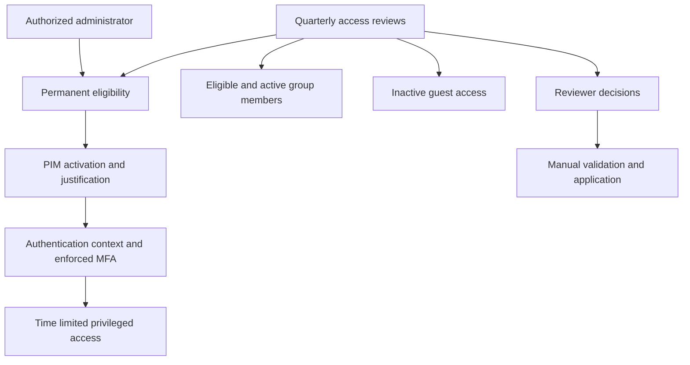

# Architecture and scope

The architecture below is illustrative. It expresses the documented control relationships, not an export of a production tenant.

The activation maximum is eight hours; permanent eligibility does not mean permanently active privilege. PIM for Groups and direct Entra role eligibility are distinct assignment surfaces. The exact production scope of the supplied PIM settings across each role and group remains to be evidenced; this diagram does not assert uniform settings everywhere.

Reviews run quarterly with a 14-day response period. Initial auto-application is disabled. Nonresponse leaves access unchanged, requiring manual follow-up. Exact authentication context identifier, policy targeting and exclusions, group-to-role mappings, review IDs, start dates, and results are not included or inferred.
